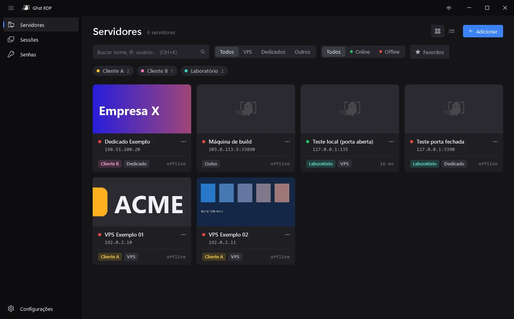
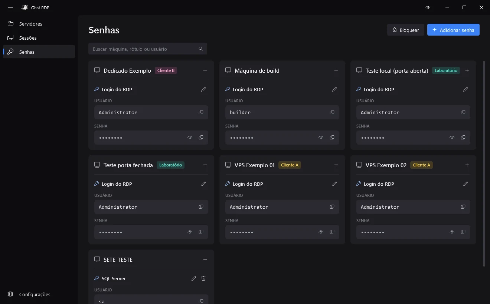
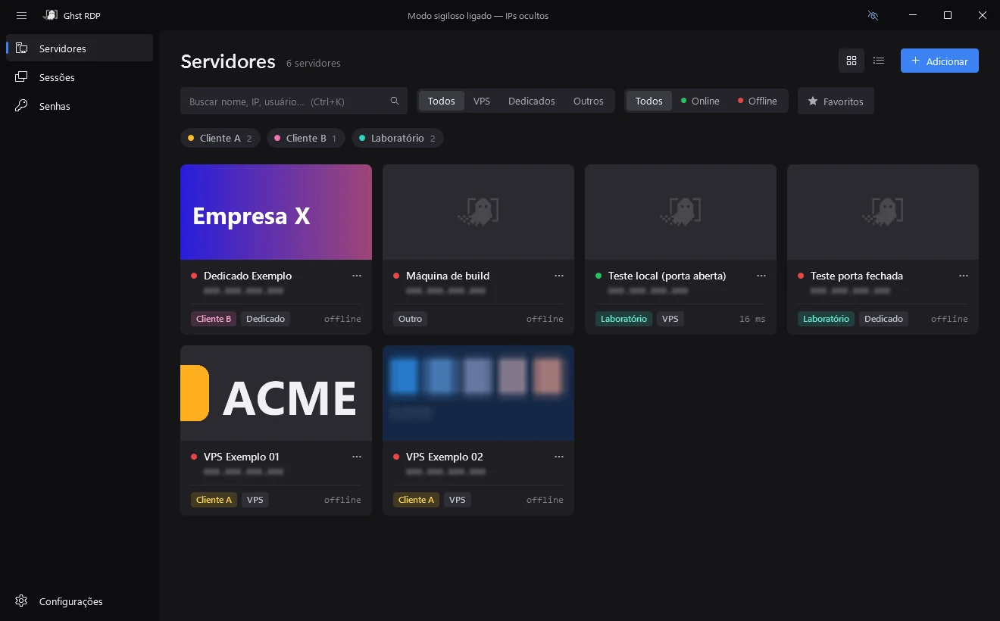

<p align="center">
  
</p>

<h1 align="center">Ghst RDP</h1>

<p align="center">
  Seus servidores RDP em um só lugar.<br />
  Um gerenciador de VPS e dedicados para Windows, grátis e open source.
</p>

<p align="center">
  <a href="https://github.com/GhosttyE/GhstRDP/releases/latest"><b>Baixar para Windows</b></a>
</p>

<p align="center">
  
</p>

## Por que existe

Quem administra muitos servidores acaba com dezenas de atalhos `.rdp`, senhas espalhadas e uma janela do mstsc para cada máquina. O Windows App da Microsoft tenta resolver isso, mas é lento e instável.

O Ghst RDP nasceu para substituir os dois no dia a dia. Você cadastra cada VPS ou dedicado uma vez e conecta com um clique. As sessões abrem em abas, como no navegador, e as senhas ficam guardadas com segurança no seu próprio PC.

Ele usa o mesmo motor de conexão da Área de Trabalho Remota do Windows (`mstscax`), então se comporta igual ao mstsc. A diferença é que organiza tudo em volta dele.

## O que ele faz

**Sessões em abas.** Abra vários servidores dentro do app e troque entre eles como abas do navegador. A resolução acompanha o tamanho da janela e a conexão volta sozinha se cair.

**Ou no mstsc, se preferir.** Cada servidor pode abrir na janela clássica da Área de Trabalho Remota, já com usuário e senha preenchidos.

**Status em tempo real.** Veja quem está online e a latência de cada máquina. Filtre por tipo, status, favoritos ou cliente.

**Organizado por cliente.** Etiquetas coloridas por empresa e um banner com a logo de cada cliente no card do servidor.

**Cofre de senhas.** Guarde as outras credenciais de cada máquina (banco, painel, SQL) protegidas por um PIN.

<p align="center">
  
</p>

**Modo sigiloso.** Vai gravar ou compartilhar a tela? Um atalho (`Ctrl+Shift+S`) troca os IPs por um endereço falso borrado e esconde as prévias das sessões.

<p align="center">
  
</p>

## Suas senhas não saem do seu PC

Não existe conta, servidor nem telemetria. Tudo fica no seu usuário do Windows, e o código está aqui para qualquer um conferir.

- **Senhas dos servidores:** criptografadas com a proteção do próprio Windows (DPAPI). Só o seu usuário, neste PC, consegue abrir.
- **Cofre com PIN:** o PIN nunca é salvo. Ele gera a chave com PBKDF2-SHA256 (310 mil rodadas), cada senha usa AES-256-GCM e por cima ainda vai o DPAPI.
- **Contra tentativas:** depois de 5 PINs errados o cofre trava por um tempo, e ele fecha sozinho quando fica parado.
- **Modo mstsc:** para o mstsc entrar sem pedir senha, o login fica salvo no Gerenciador de Credenciais do Windows (`TERMSRV/host`). Ele é removido quando você apaga o servidor ou troca o login.

O cofre protege contra quem usa o seu PC ou olha a sua tela. Ele não protege contra um programa malicioso rodando no seu próprio usuário do Windows; nesse caso, nenhum gerenciador de senhas local protege.

## Instalar

Baixe o `GhstRDPApp-win-Setup.exe` na [última versão](https://github.com/GhosttyE/GhstRDP/releases/latest) e abra.

Ele instala só para o seu usuário, sem pedir administrador e sem precisar do .NET. Depois disso o app se atualiza sozinho quando sai versão nova; se preferir controlar, dá para desligar em Configurações.

> O executável ainda não tem assinatura digital, então o Windows pode mostrar o aviso do SmartScreen. Clique em *Mais informações* → *Executar assim mesmo*.

Requer Windows 10 ou 11.

<details>
<summary><b>Para desenvolvedores</b></summary>

<br />

Feito em C# com WPF e .NET 10. O RDP embutido usa o controle ActiveX do `mstscax.dll`; o instalador e as atualizações usam o [Velopack](https://velopack.io).

**Rodar a partir do código** (precisa do .NET 10 SDK):

```powershell
dotnet run --project src\GhstRDP\GhstRDP.csproj
```

**Lançar uma versão:** envie uma tag `v*` (por exemplo `git tag v1.1.0` e `git push origin v1.1.0`). O workflow em `.github/workflows/release.yml` gera o instalador e publica o Release.

**Onde ficam os dados:**

- `%APPDATA%\GhstRDP\`: servidores, configurações, cofre e banners.
- `%LOCALAPPDATA%\GhstRDP\`: arquivos `.rdp`, prévias e logs.
- `GHSTRDP_HOME=<pasta>`: usa outra pasta, útil para testar sem mexer nos dados reais.

**Outros:** `tools\gen-interop.ps1` regenera as DLLs de interop em `lib\`, e `tools\make-assets.py` regenera o ícone a partir de `art\`.

</details>

## Licença

[MIT](LICENSE). Use, estude e modifique à vontade.
